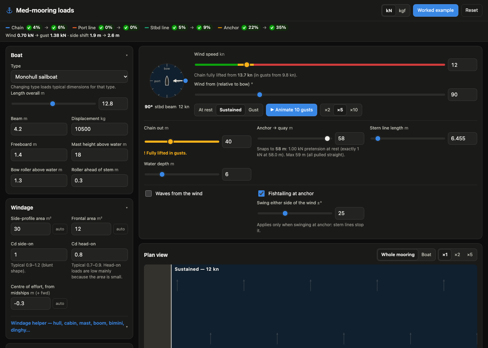
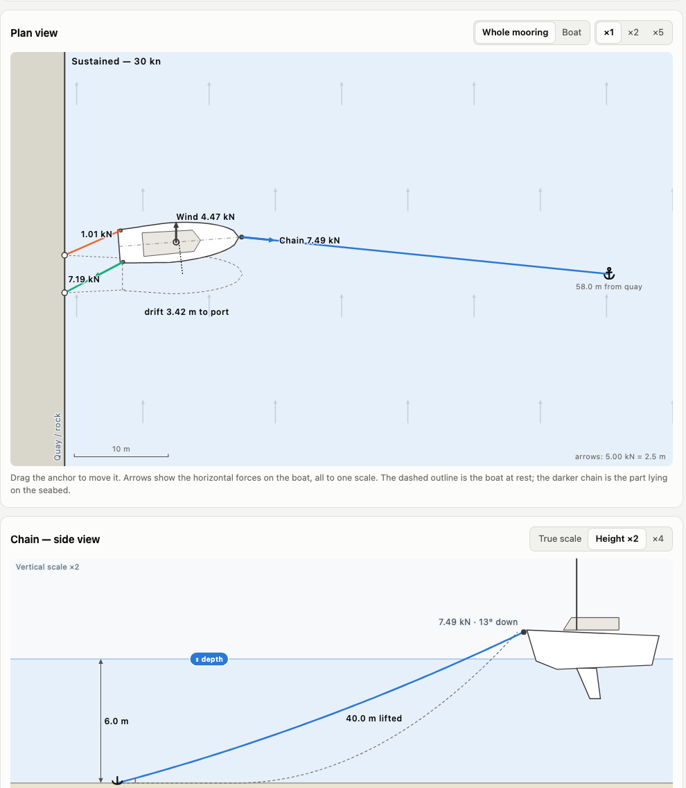
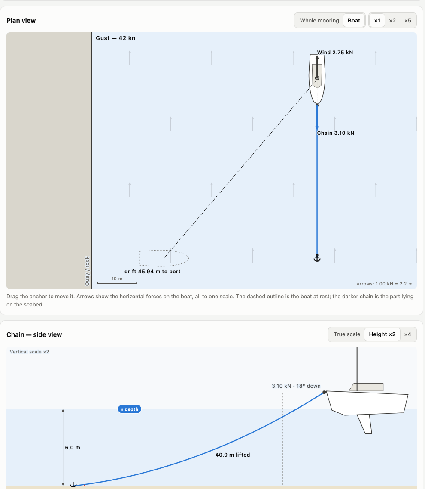
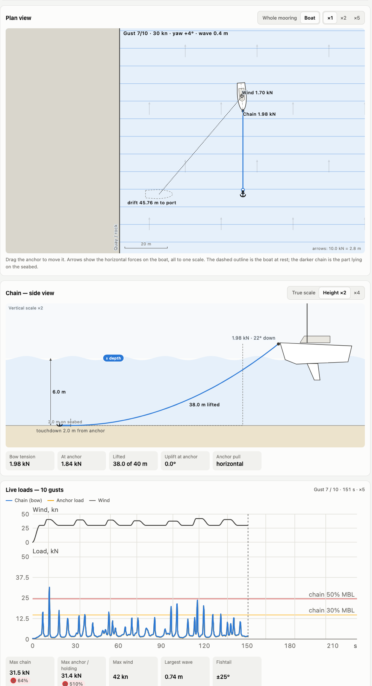
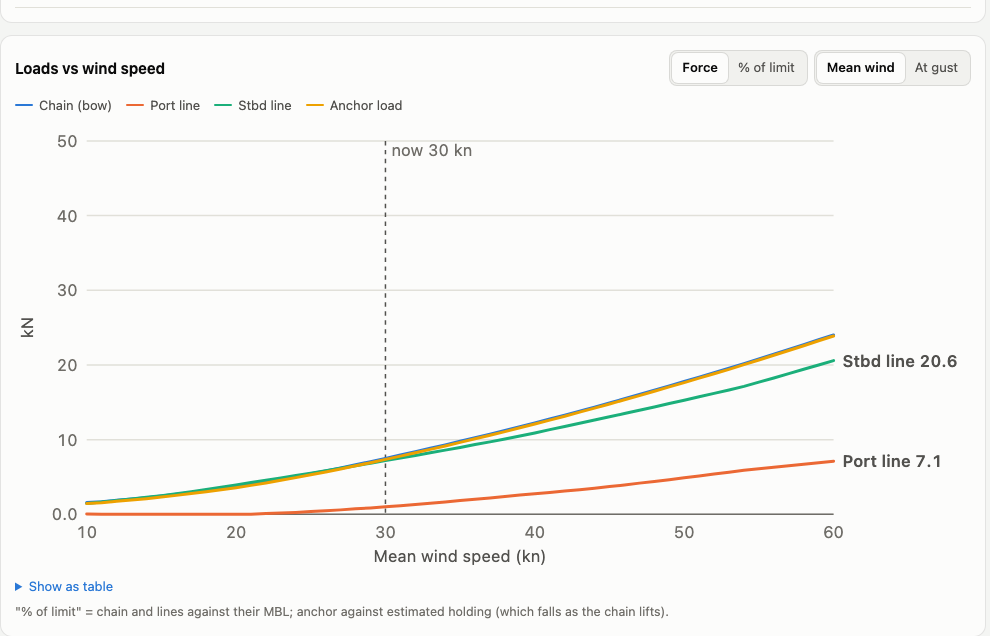
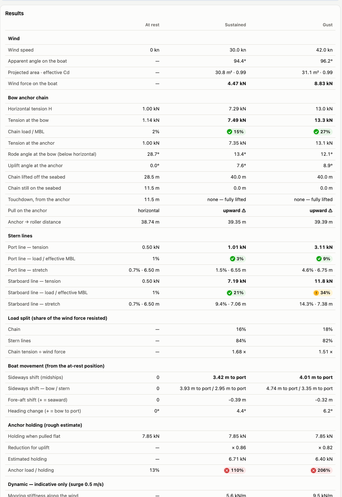
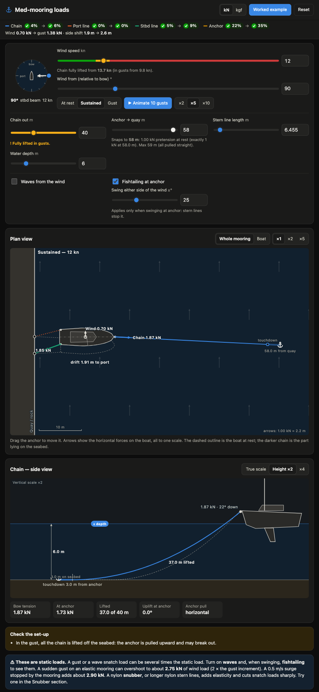

# Will Anchor Hold

A single-page, offline web app that calculates the loads on a boat Med-moored with a bow anchor and one or
two stern lines to a quay or rock, when the wind blows from the side.

It gives the wind force on the boat, the chain catenary (tension at bow and anchor, uplift, chain lifted
off the seabed), the stern-line tensions, the boat's equilibrium position (sideways shift, fore-aft shift and
heading change), how the load splits between chain and lines, and safety margins against MBL and
estimated anchor holding.

## Screenshots

All in dark mode, with the wind in the amber zone (chain fully lifted in gusts, not yet at the mean wind).
The Med-moored shots use the worked-example boat (12.8 m monohull, 40 m of 10 mm chain, two 6.5 m stern lines)
at 12 kn beam-on, gusts 17 kn:



| Plan and chain side view | Swinging at anchor at 26 kn, 0.15 m waves, fishtailing ±25° |
|---|---|
|  |  |

The 10-gust animation of the swinging case, with the waves, fishtailing and live load traces:



| Loads from 10 to 60 kn | Results table |
|---|---|
|  |  |

On a phone:



## Use it

```bash
npm install
npm run build
```

`dist/index.html` is one self-contained file (≈ 95 kB, no network needed). Copy it to your laptop or phone
and open it in a browser. Your inputs are saved in that browser's `localStorage`.

> **iPhone:** the Files app preview does not run JavaScript. Open the file with an app that can show local
> HTML with JavaScript enabled, or serve it once from any web host.

For development: `npm run dev` (live reload), `npm test` (unit tests).

## Layout

See [docs/architecture.md](docs/architecture.md) for the structure, the data flow and how to extend it.

| Path | What |
|---|---|
| `src/physics/` | Calculation engine, no DOM, SI units. Layers: `core` → `materials`, `environment` → `mooring` → `dynamics` → `analysis` |
| `src/app/` | App shell: shared context, store (input rules), scheduler (when to compute), render, interactions, animation, layout |
| `src/ui/` | View functions: plan and side views, results table, charts, status bar, controls, app state |
| `src/styles/` | Stylesheets, one per component, in cascade order |
| `src/**/*.test.ts` | Unit, validation and golden-master UI tests (`npm test`) |
| `docs/worked-example.md` | A complete case to check by hand. Also shown in the app. |
| `docs/validation.md` | Validation against NREL MoorPy, numerical integration, published data and measurements |
| `docs/missing-features.md` | What the simulator leaves out today and where each piece would fit |

## Model and limits

Quasi-static wind loads; no current. Optional waves (drift force + surge simulation) and fishtailing at anchor are simplified and indicative. Wind acts at one centre of effort,
straight downwind. Flat, frictionless seabed. Stern lines are straight. Anchor holding is a rough
guide. A gust or wave snatch load can be several times the static values. The app shows an indicative
snatch estimate, and a snubber can be modelled.
